# Time on the Water · 水面时光

English | [中文](README.md)

A single-file 3D fishing game: a quiet lake at dawn, a cast, one bite, and a fish to bring in. Every scene, fish and UI element is generated in code — the whole project is one `index.html` you can download and double-click.

- **No dependencies, no build step**: three.js r160 and post-processing are inlined; no CDN, npm or backend.
- **One codebase for desktop and mobile**: mouse and touch both work, and portrait phones get the full experience.
- **Bilingual UI**: switch between Chinese and English from the top-right corner.
- **Plays offline**: runs without a network or straight from `file://`, with compatibility handling for WeChat's in-app browser.

## Why this exists

- You want a quiet few minutes of fishing without installing a client or waiting for assets to load.
- You want a small web game that can be hosted, embedded or shared as-is.
- You want a reference for a single-file three.js build that relies entirely on procedural art.

## Features

- **Casting**: hold to charge and release to cast; distance scales from 7–46 m, and the camera follows the cast.
- **Bite**: strike the moment the float goes under. The bite window varies by species, and you can reel in while waiting.
- **Fight**: hold to reel, release to give line, and keep the tension needle in the green zone. Red snaps the line, yellow throws the hook, and fish make sudden runs.
- **15 species**: 5 freshwater and 10 saltwater fish, each with its own weight, length, strength and rarity, plus a catch log and fish dex.
- **Atmosphere**: procedural shoreline and hills, water ripples, a picture-in-picture float camera, birds, jumping fish, ripples and particles, Bloom + FXAA.
- **Convenience**: left/right-handed rod toggle, sound toggle, catch history, release fish to earn merit, and progress saved in `localStorage`.
- **Bilingual**: every label, fish name and tip has an English version.

## Screenshots

### Desktop (1440×900)

| Start | Core loop: fight | Result |
| --- | --- | --- |
| 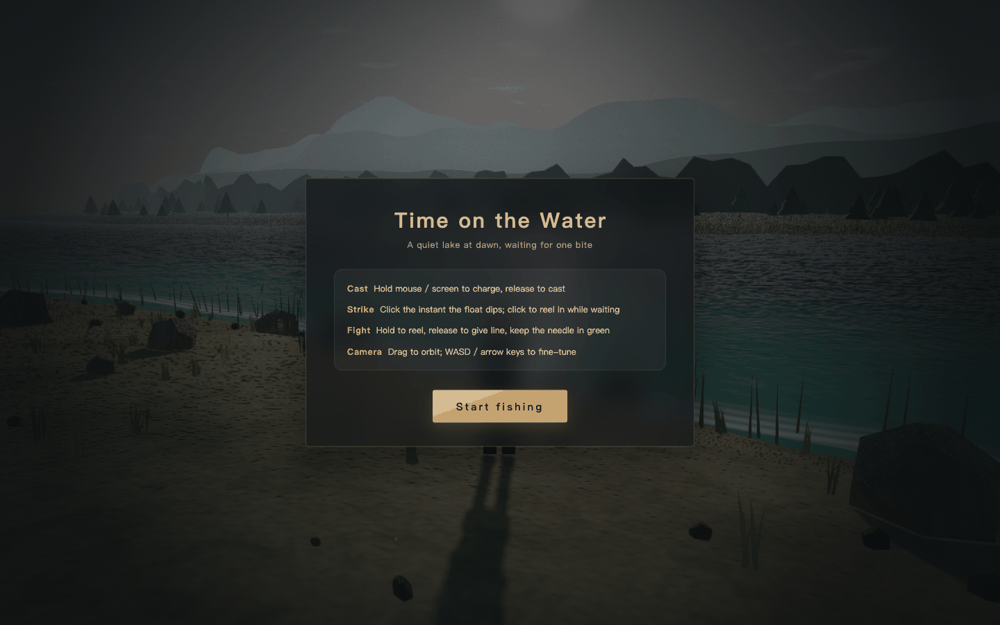 | 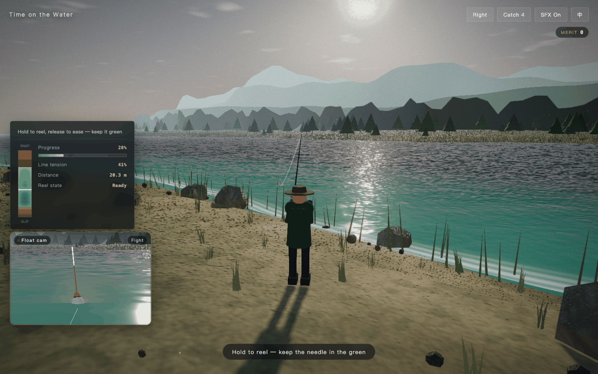 | 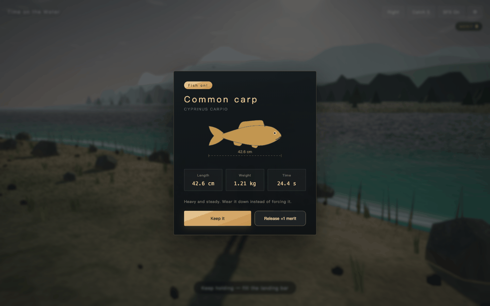 |

More of the loop: charging the cast, the bite, the catch log and the fish dex.

| Casting | Bite | Catch log | Fish dex |
| --- | --- | --- | --- |
| 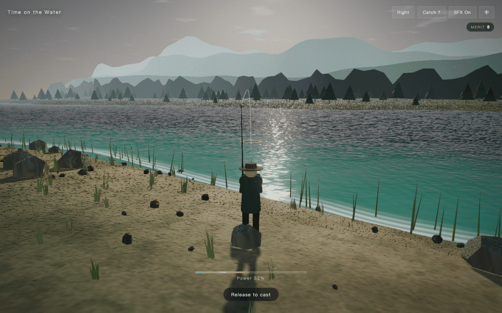 | 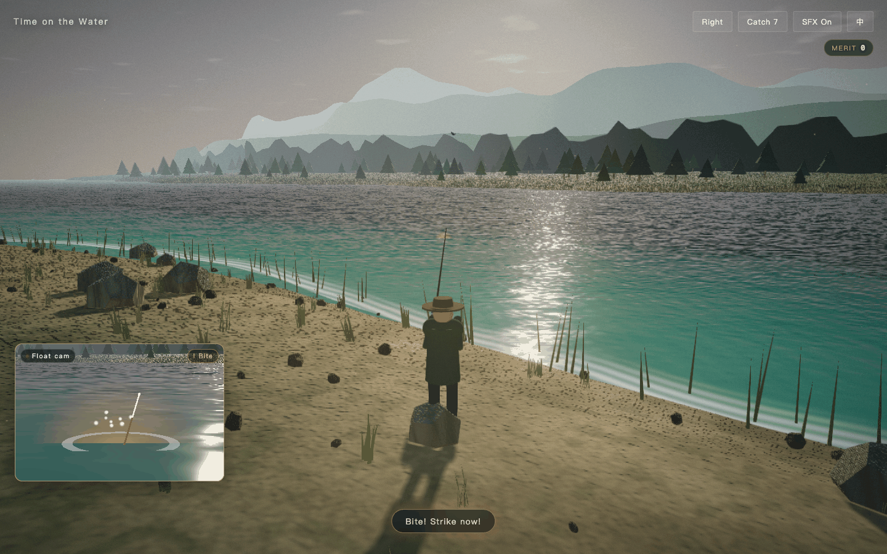 | 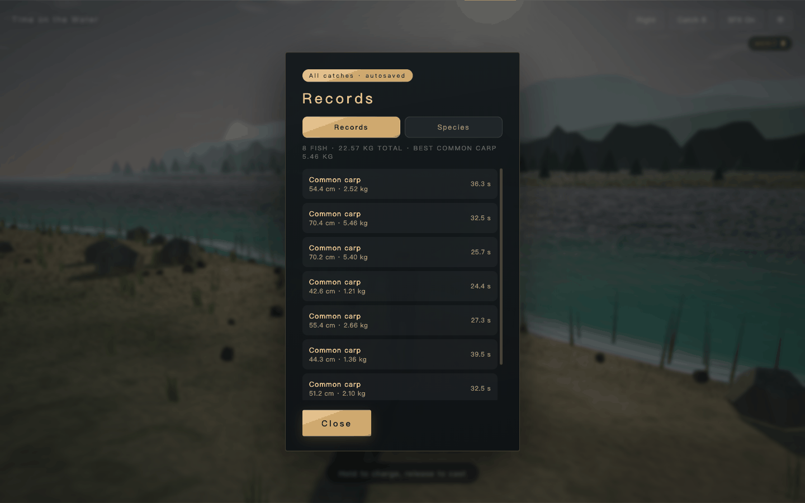 | 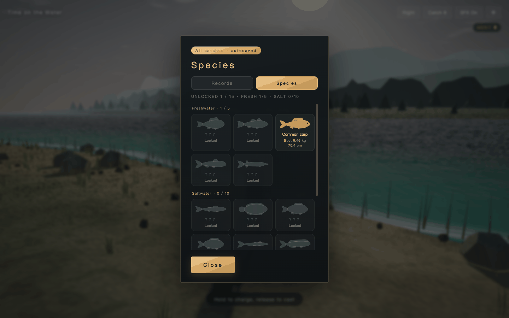 |

### Mobile (390×844, DPR 2)

| Start | Fight | Result |
| --- | --- | --- |
| 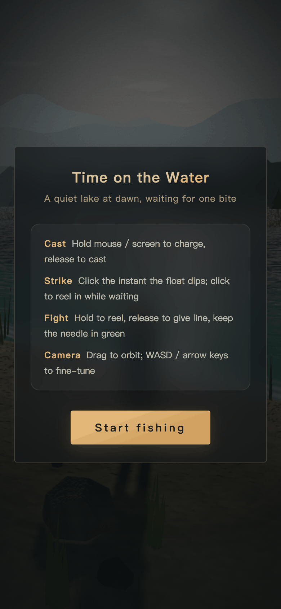 | 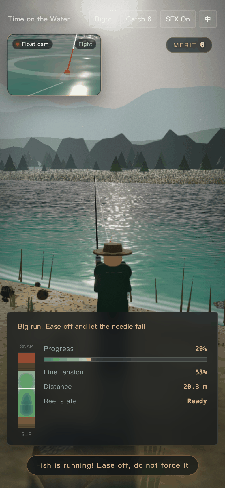 | 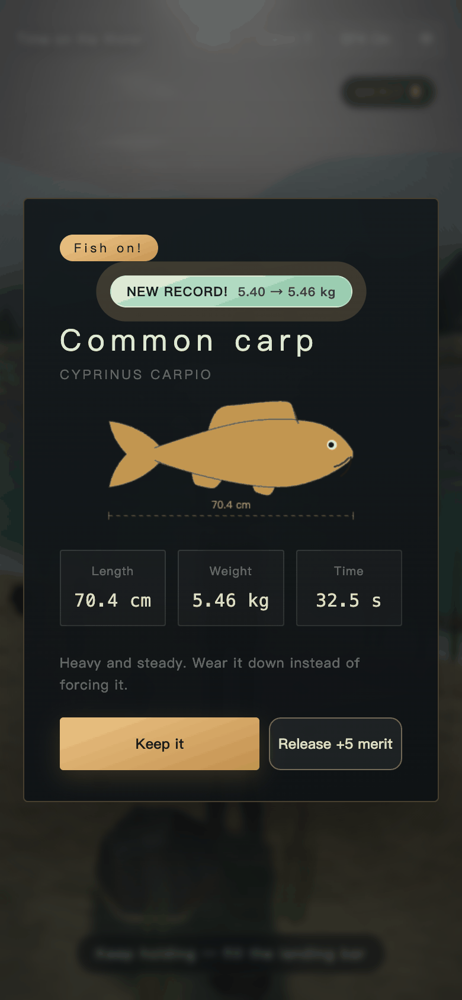 |

More of the loop on a phone.

| Casting | Bite | Catch log | Fish dex |
| --- | --- | --- | --- |
| 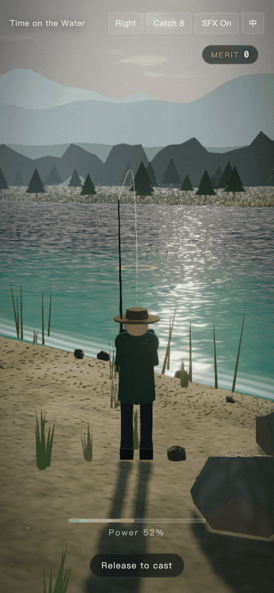 | 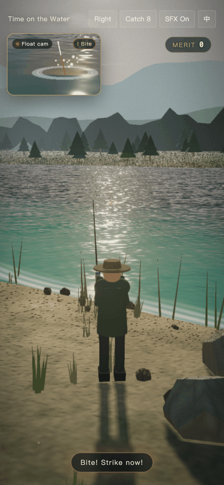 | 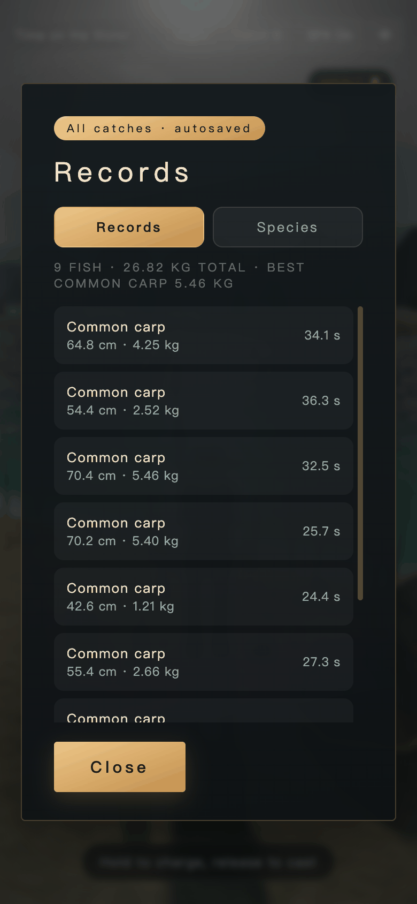 | 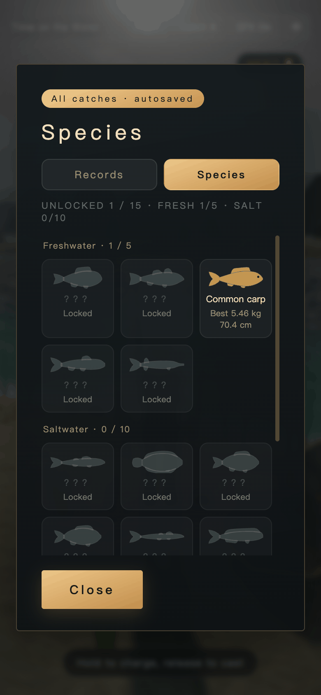 |

Chinese screenshots are in the [Chinese README](README.md).

## Quick start

### Requirements

- A modern browser with WebGL (Chrome, Edge, Safari or Firefox from the last two years) and hardware acceleration enabled.
- Any static file server; Python 3 is recommended and usually preinstalled on macOS and Linux. Node.js, npm and any install step are not required.

### Install

Nothing to install. Clone or download the repository.

### Run

```bash
cd fish
python3 -m http.server 8123
```

Open `http://127.0.0.1:8123/index.html`.

You can also double-click `index.html` and open it over `file://`; a local server is closer to the deployed setup.

### Controls

| Action | Desktop | Mobile |
| --- | --- | --- |
| Cast | Hold the left mouse button to charge, release to cast | Press and hold the screen to charge, release to cast |
| Strike | Click when the float goes under | Tap when the float goes under |
| Fight | Hold to reel, release to give line | Hold to reel, release to give line |
| Camera | Drag with the mouse; WASD / arrow keys to nudge | Drag with one finger |
| Reel in | Click / Space / R while waiting | Tap while waiting |

## Project structure

```text
fish/
├── index.html                  # the whole game: UI, styles, three.js r160, game logic
├── favicon.svg                 # vector icon: bobber on the water
├── docs/screenshots/           # screenshots used by both READMEs
├── README.md                   # Chinese
├── README.en.md                # English
├── THIRD-PARTY-NOTICES.md      # third-party components and licenses
├── LICENSE                     # AGPL-3.0
└── .gitignore
```

`index.html` is about 884 KB, most of it the inlined three.js and post-processing code. There is no build output and nothing to bundle. Tunable parameters live in the `CONFIG` object inside the file: cast feel, bite windows, tension, and the species table.

## Deployment

This is a purely static site, so any static host works.

### Netlify (current demo)

- Demo: <https://effervescent-valkyrie-652067.netlify.app>
- Build command: leave empty
- Publish directory: repository root
- You can also drag the project folder into Netlify Drop

### Other options

GitHub Pages, Cloudflare Pages, Vercel, static object storage, Nginx — anything that can serve `index.html`. No Node runtime, environment variables or server endpoints required.

## Mobile support

Tested at 390×844 with DPR 2: the start screen, fight, result and catch panels all avoid horizontal scrolling, dialogs are 351 px wide, buttons and the tension bar stay fully visible, touch casting and reeling work, and the portrait layout holds up.

Known rough edges (playable, but worth improving):

- Top-bar buttons are about 30 px tall, below the 44 px touch target Apple recommends.
- The mobile onboarding still says "hold the mouse" and "WASD / arrow keys", which doesn't match touch input.
- Desktop and mobile share the same onboarding copy; it isn't adapted to the input method yet.

## Third-party components and licenses

The project's own code is licensed under **AGPL-3.0**. The inlined three.js r160 and its post-processing modules remain under the MIT license, and the FXAA shader remains under NVIDIA's BSD-3-Clause license, with their original copyright notices preserved. See [THIRD-PARTY-NOTICES.md](THIRD-PARTY-NOTICES.md) for the full component list, versions, copyright lines and license texts.

## License

This project is released under the **GNU Affero General Public License v3.0 (AGPL-3.0)**. The full terms are in [LICENSE](LICENSE).

- Personal and commercial use, modification and distribution are permitted.
- Derivative works must also be licensed under AGPL-3.0.
- If a modified version is offered to users over a network, those users must also be able to obtain the complete corresponding source code.
- This is a plain-language summary, not legal advice; the official text in `LICENSE` governs.

## Support this project

If this little game bought you a quiet moment by the water, you can support future updates with USDT. Please use only the addresses below:

```text
Network: TRON (TRC20)
Currency: USDT
Address: TXXXXXXXX...
```

```text
Network: Ethereum (ERC20)
Currency: USDT
Address: 0xXXXX...
```

> Only the addresses above are valid. Any other address, QR code, or request for a private key is a scam. Do not send funds.

## Data and privacy

- There is no backend and no account system, and no gameplay data is uploaded.
- Catch records, merit, language and rod-handedness are stored only in browser `localStorage`; clearing site data resets them.
- The page contains no third-party analytics, advertising or tracking scripts.
- The demo is hosted on Netlify; the hosting platform may keep its own access logs, which is outside this project's code.
