# 水面时光 · Time on the Water

一个单文件的 3D 垂钓小游戏：清晨的湖岸，抛竿、等一个咬口、把鱼遛上岸。全部场景、鱼和界面都由代码实时生成，整个项目只有一个 `index.html`，下载下来双击就能玩。

- **零依赖、零构建**：three.js r160 与后期处理直接内联，不依赖 CDN、npm 或后端。
- **桌面与手机同一套代码**：鼠标、触屏都能操作，竖屏手机体验完整。
- **中英双语**：界面右上角可实时切换。
- **离线可玩**：断网或直接用 `file://` 打开也能运行，并针对微信内置浏览器做了兼容处理。

## 解决什么问题

- 想随手玩一段安静的钓鱼，不想装客户端、不想等资源加载；
- 想找一个可以直接托管、嵌入或分享的网页小游戏；
- 想参考一个不依赖美术素材、纯程序化生成的 three.js 单文件实现。

## 主要功能

- **抛竿**：按住蓄力，松开抛出，落点距离随蓄力在 7–46 m 之间变化，镜头跟随抛投方向。
- **咬口**：浮漂下沉的瞬间扬竿；不同鱼种的咬口窗口不同，空等时可以主动收杆。
- **遛鱼**：按住收线、松手放线，让张力指针停在绿色区间；红区断线、黄区脱钩，鱼还会突然发力。
- **15 种鱼**：5 种淡水鱼 + 10 种海水鱼，体重、长度、力量、稀有度各不相同，附带「鱼鉴」收集。
- **环境演出**：程序化湖岸与远山、水面波纹、浮漂视角画中画、鸟群、跃鱼、涟漪与粒子、Bloom + FXAA 后期。
- **辅助功能**：右手/左手持竿切换、音效开关、鱼获记录、放流积「功德」，进度自动保存在浏览器本地。
- **中英双语**：所有界面文案、鱼名、鱼种提示均提供英文版本。

## 界面截图

### 桌面版 · 中文（1440×900）

| 首页 | 核心交互：遛鱼 | 结果页 |
| --- | --- | --- |
| 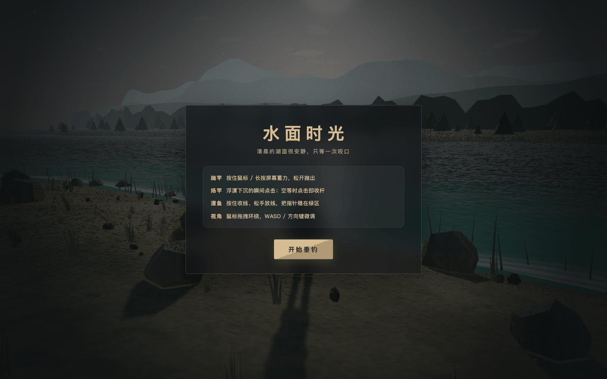 | 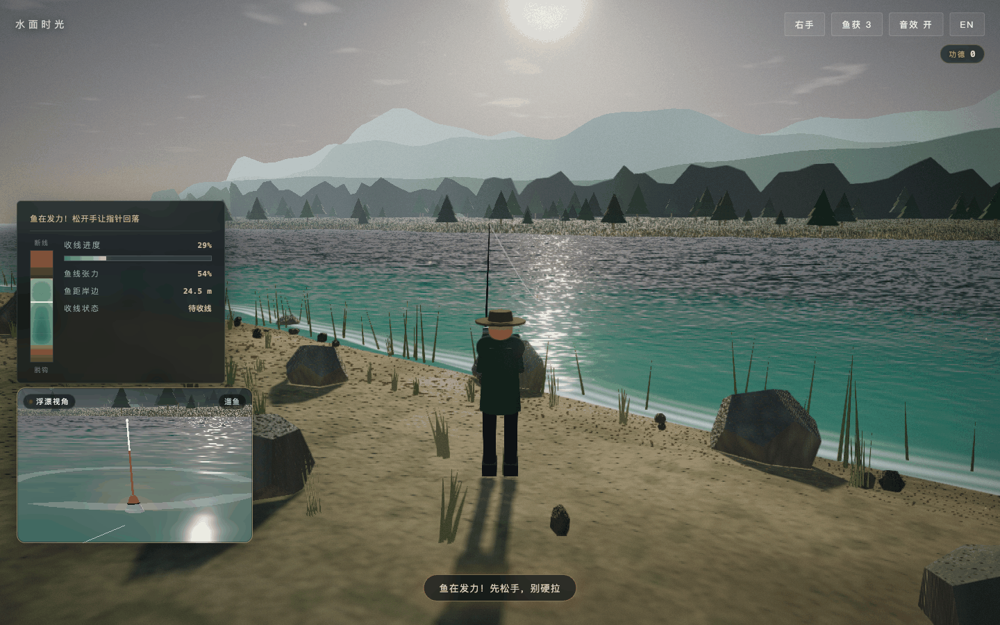 | 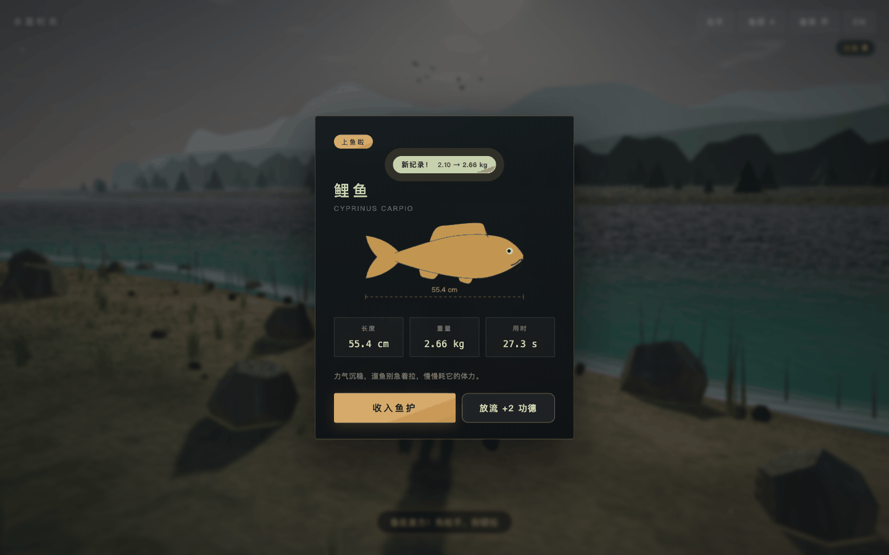 |

流程图补充：蓄力抛竿、咬口瞬间、鱼获记录与鱼鉴。

| 蓄力 | 咬口 | 鱼获记录 | 鱼鉴 |
| --- | --- | --- | --- |
| 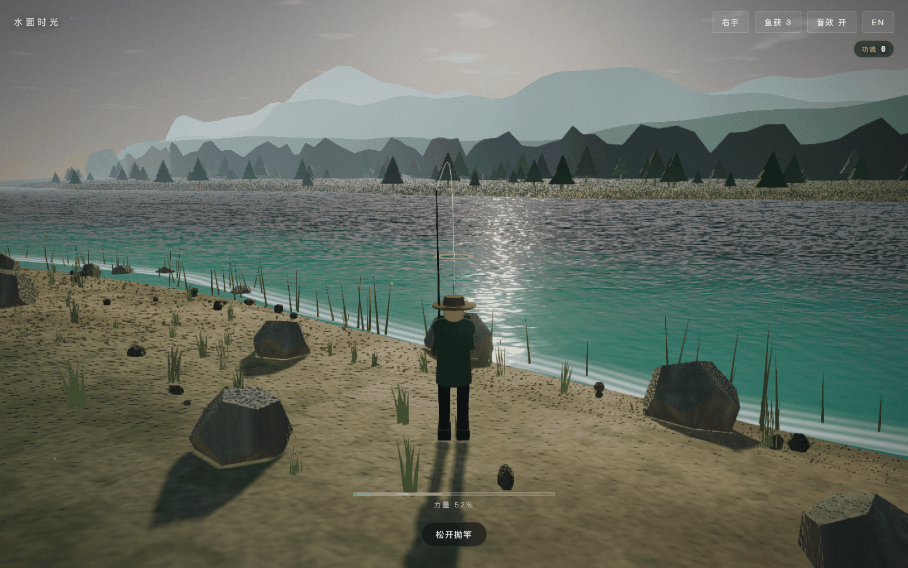 | 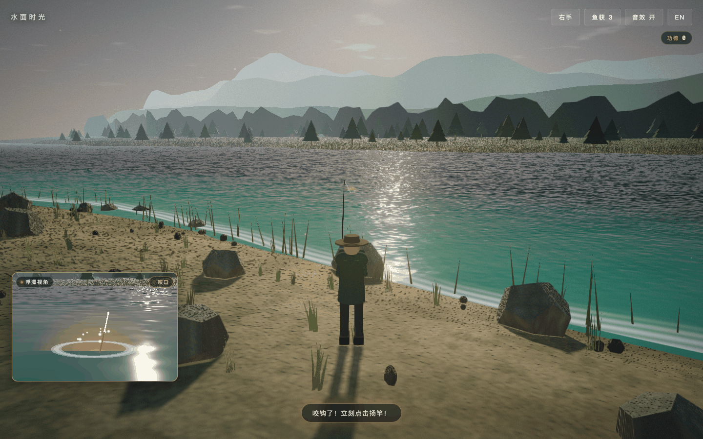 | 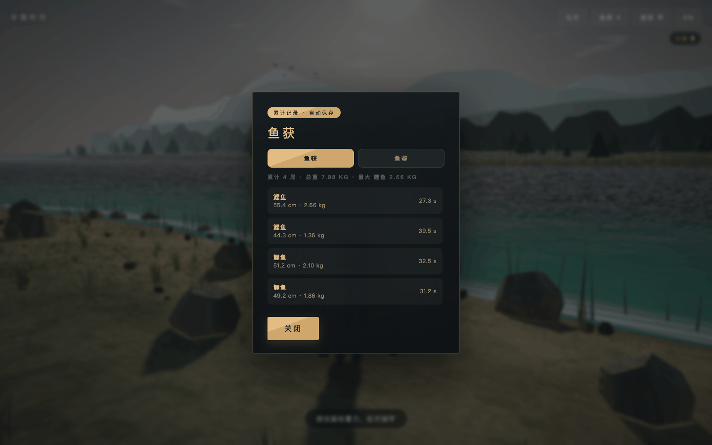 | 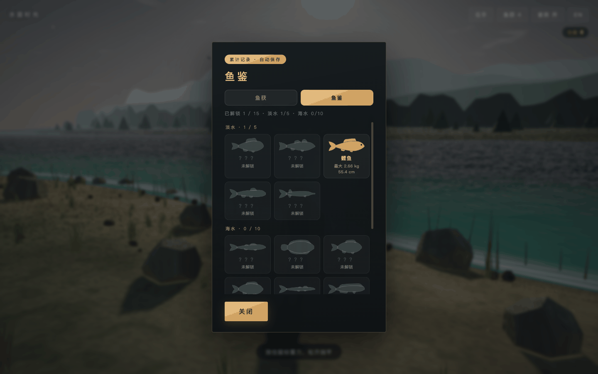 |

### 桌面版 · English（1440×900）

| Start | Fight | Result |
| --- | --- | --- |
| 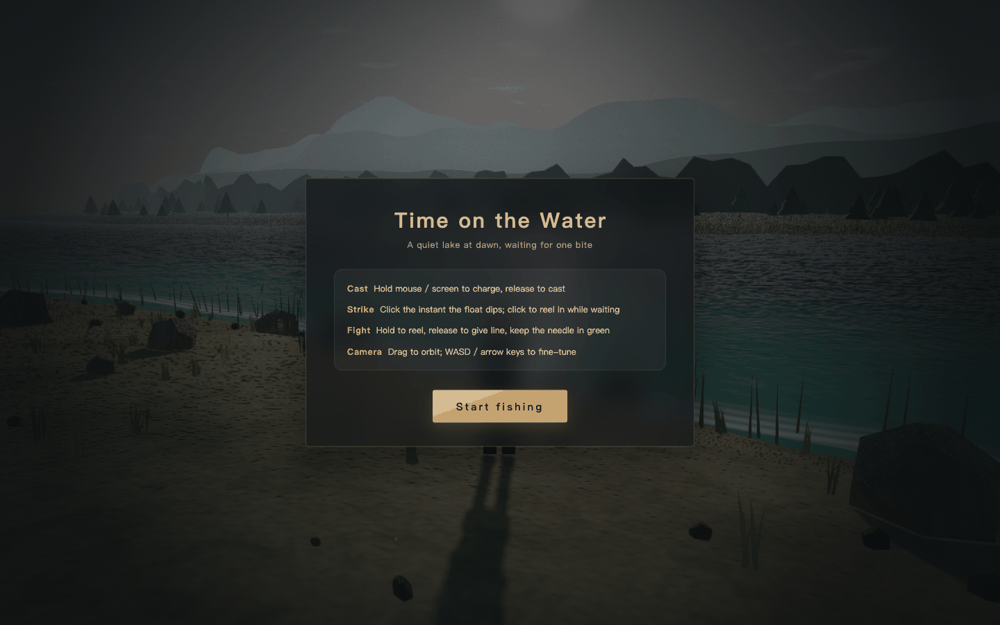 | 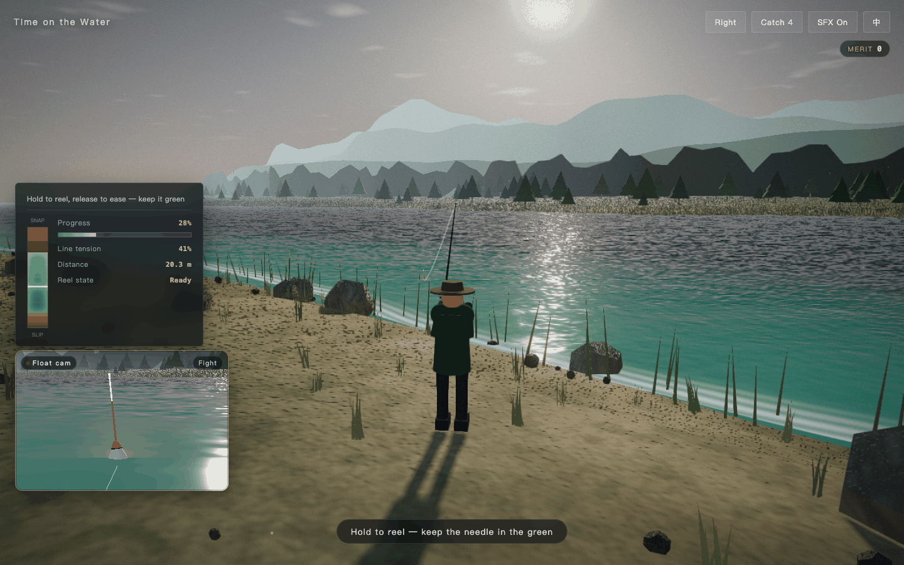 | 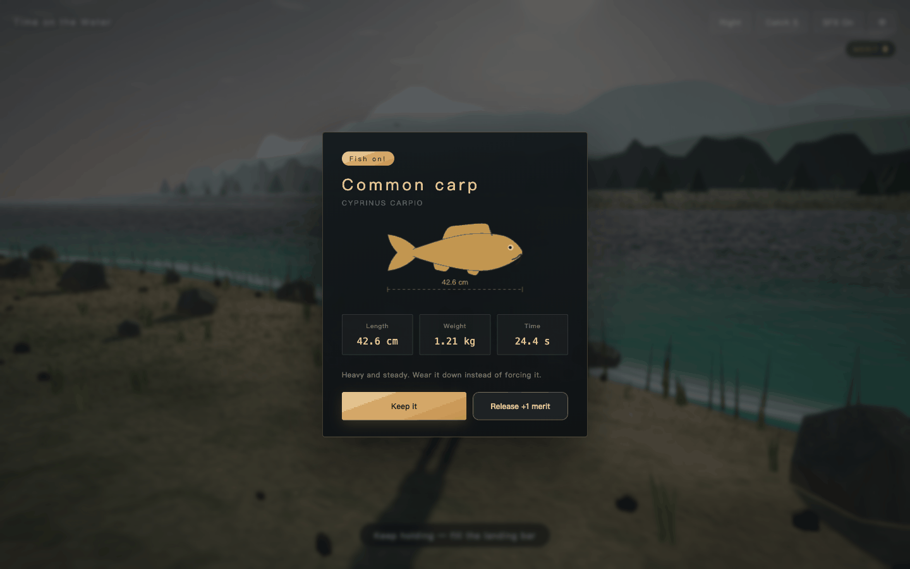 |

### 移动版 · 中文（390×844，DPR 2）

| 首页 | 遛鱼 | 结果页 |
| --- | --- | --- |
| 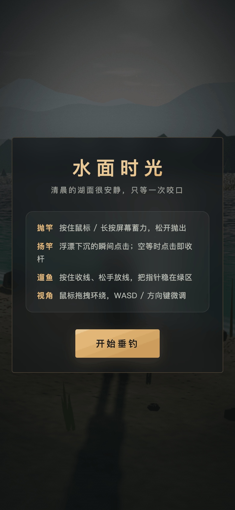 | 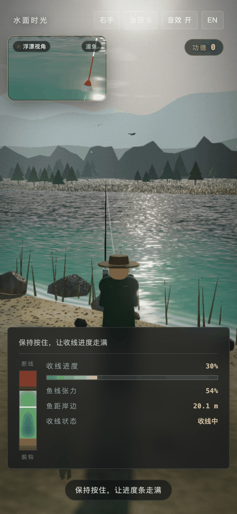 | 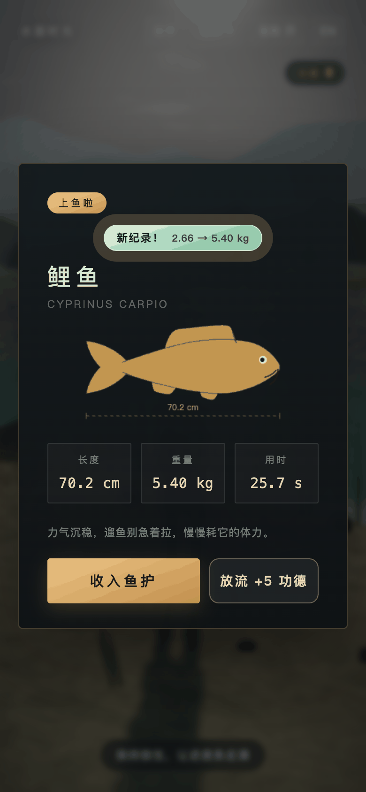 |

### 移动版 · English（390×844，DPR 2）

| Start | Fight | Result |
| --- | --- | --- |
| 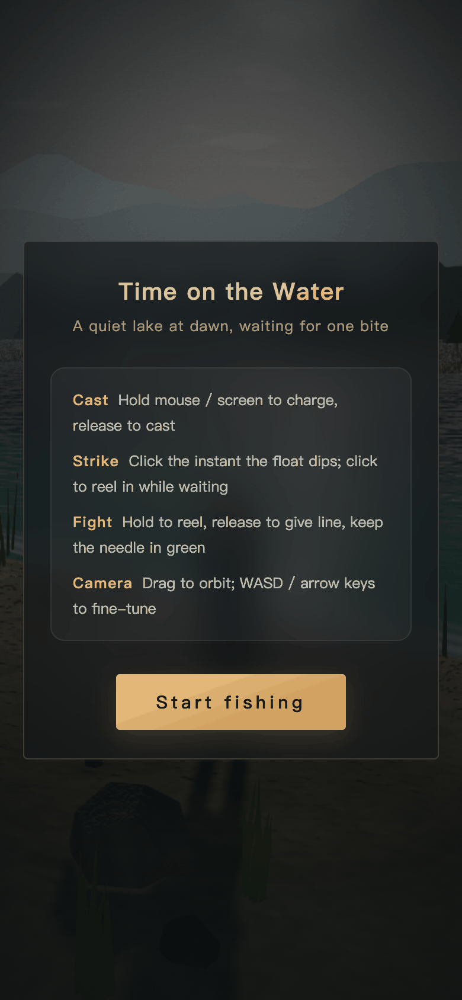 | 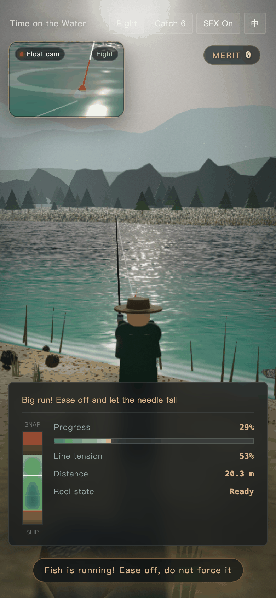 | 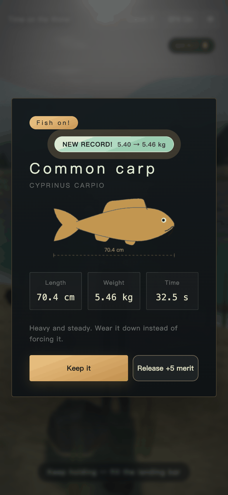 |

## 快速开始

### 环境要求

- 支持 WebGL 的现代浏览器（Chrome / Edge / Safari / Firefox 近两年版本），并开启硬件加速；
- 一个静态文件服务器即可，推荐 Python 3（macOS / Linux 通常自带），不需要 Node.js、npm 或任何安装步骤。

### 安装

没有依赖需要安装。克隆或下载本仓库即可。

### 启动

```bash
cd fish
python3 -m http.server 8123
```

浏览器打开 `http://127.0.0.1:8123/index.html`。

也可以直接双击 `index.html` 用 `file://` 打开；本地服务器方式更接近线上部署环境。

### 操作

| 动作 | 桌面 | 手机 |
| --- | --- | --- |
| 抛竿 | 按住鼠标左键蓄力，松开抛出 | 长按屏幕蓄力，松开抛出 |
| 扬竿 | 浮漂下沉时点击 | 浮漂下沉时轻点 |
| 遛鱼 | 按住收线，松手放线 | 按住收线，松手放线 |
| 视角 | 鼠标拖拽环绕；WASD / 方向键微调 | 单指拖拽环绕 |
| 收杆 | 空等时点击 / 空格 / R | 空等时轻点 |

## 目录结构

```text
fish/
├── index.html                  # 游戏本体：界面、样式、three.js r160 与全部逻辑
├── docs/screenshots/           # README 使用的中英 / 桌面移动截图
├── README.md
├── THIRD-PARTY-NOTICES.md      # 第三方组件与许可声明
├── LICENSE                     # AGPL-3.0
└── .gitignore
```

`index.html` 约 884 KB，其中大部分是内联的 three.js 与后期处理代码；项目没有构建产物，也不需要打包。所有可调参数集中在文件内的 `CONFIG` 对象里（抛投手感、咬口窗口、遛鱼张力、鱼种表等）。

## 部署

这是一个纯静态站点，任何静态托管都能直接使用。

### Netlify（当前演示）

- 演示地址：<https://effervescent-valkyrie-652067.netlify.app>
- 构建命令：留空
- 发布目录：仓库根目录
- 也可以把整个项目目录直接拖进 Netlify Drop 完成部署

### 其它方式

GitHub Pages、Cloudflare Pages、Vercel、对象存储静态网站、Nginx 等均可，只需保证 `index.html` 可被访问。无需 Node 运行时、环境变量或服务端接口。

## 移动端支持

已在 390×844、DPR 2 的移动视口实测：首页、遛鱼、结算、鱼获面板均无横向滚动，弹窗宽度 351 px，按钮和色条完整可见，触屏蓄力/收线可用，竖屏布局正常。

已知不足（不影响游玩，但建议后续改进）：

- 顶栏按钮高度约 30 px，低于 iOS 建议的 44 px 触控目标；
- 手机端的新手说明仍写着「按住鼠标」「WASD / 方向键」，与实际触屏操作不一致；
- 桌面与手机共用同一套说明文案，尚未按输入方式区分。

## 第三方组件与许可

本项目主体代码以 **AGPL-3.0** 授权；内联的 three.js r160、three.js 后期处理模块遵循 MIT，FXAA 着色器遵循 NVIDIA 的 BSD-3-Clause，各自保留原许可与版权声明。完整的组件清单、版本、版权行与许可全文见 [THIRD-PARTY-NOTICES.md](THIRD-PARTY-NOTICES.md)。

## 授权

本项目以 **GNU Affero General Public License v3.0（AGPL-3.0）** 发布，完整条款见 [LICENSE](LICENSE)。

- 允许个人和商业使用、修改与分发；
- 衍生作品必须继续以 AGPL-3.0 授权；
- 如果修改后的版本通过网络向用户提供服务，也必须向这些用户提供对应的完整源代码；
- 以上是对许可证的通俗说明，不构成法律建议；以 `LICENSE` 中的正式文本为准。

## 支持这个项目

如果这个小游戏让你在水边安静了一会儿，可以用 USDT 支持后续更新。请只使用下面列出的地址：

```text
网络：TRON (TRC20)
币种：USDT
地址：TXXXXXXXX...
```

```text
网络：Ethereum (ERC20)
币种：USDT
地址：0xXXXX...
```

> 仅以上地址有效。任何其它地址、二维码或索要私钥的行为均为诈骗，请勿转账。

## 数据与隐私

- 没有后端、没有账号系统，也不会上传任何游戏数据；
- 鱼获记录、功德、语言和持竿手仅保存在浏览器 `localStorage`，清除站点数据即会重置；
- 页面不包含第三方统计、广告或追踪脚本；
- 演示站托管在 Netlify，托管平台自身可能记录访问日志，这与本项目代码无关。
